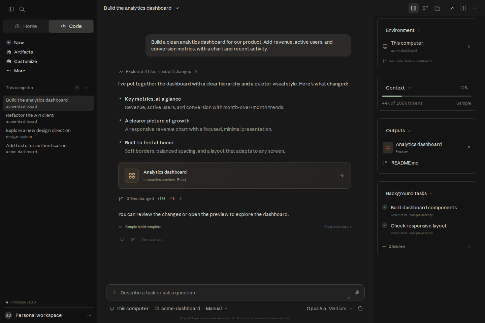
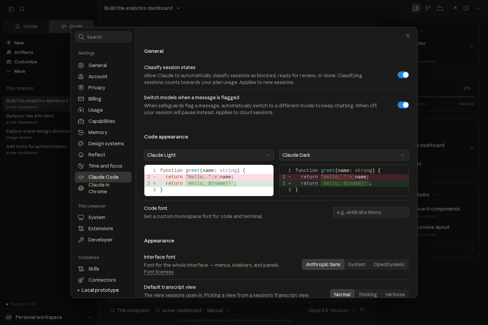
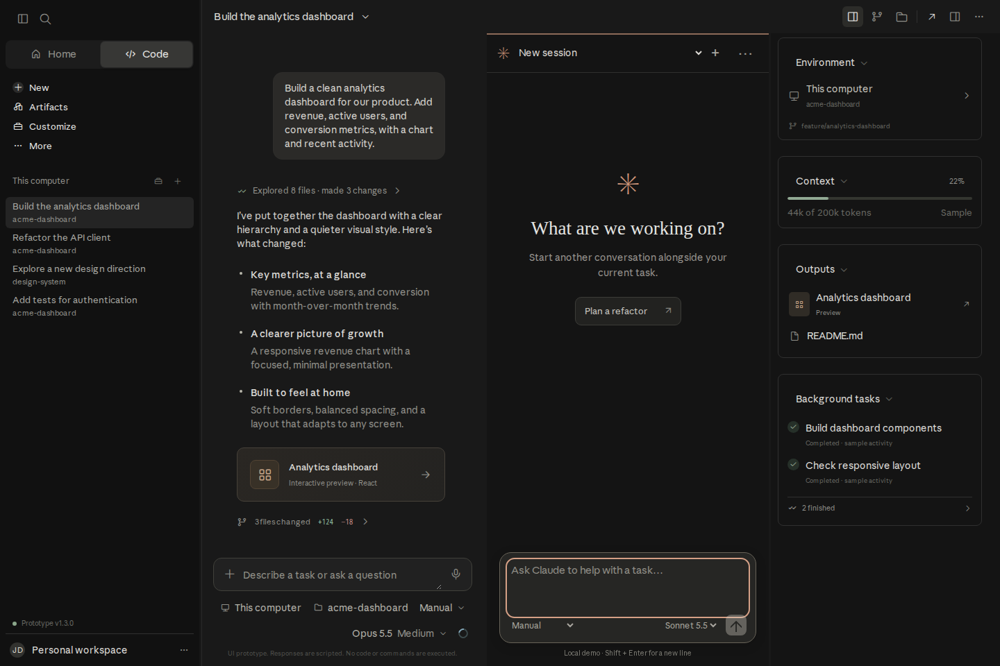

# Code Workspace

An independently authored, interactive Claude Code-style web UI prototype.

## Run

```sh
npm install
npm run dev
```

Production: `npm run build`; inspect the build with `npm run preview`.

## Stack and fidelity

React, TypeScript, Vite, Tailwind CSS, and the installed Anthropicons variable icon resource. React, TypeScript, Vite, and Tailwind were identified in the inspected desktop package. The application source here is independently authored; the reconstruction includes extracted Anthropic font/icon resources and two desktop empty-state SVG illustrations, with recorded source paths and hashes in `public/fonts/manifest.json` and `public/reference-assets/manifest.json`. It does not include Anthropic application modules or private packages. Electron, native OS integrations, and Claude's private backend are not part of a browser prototype.

Implemented: responsive sidebar and session rail; persistent local sessions and forks; scripted send/stop flow; file attachments by filename only; read-only example file tree; illustrative diff; interactive dashboard preview; demo terminal (help/pwd/ls/clear only); search; rename/export; projects; locally saved schedules; customization preferences; dark/light appearance; modal keyboard focus containment.

Demo boundaries: no AI calls, shell execution, filesystem access, automatic scheduling, external integrations, or actual source-code changes. Model/permission/environment choices are UI controls only. Browser-local storage is specific to each origin. New deployments open with sample data.

## Validation

- TypeScript and Vite production build.
- Browser checks: Files, Changes, dashboard period selection; message submission and scripted response; permission selection; schedule creation, reload persistence, and removal.
- Desktop and mobile layout inspection.

The Sites deployment is configured in `.openai/hosting.json`.

Public app: https://serebano.github.io/claude-code-web-prototype/

GitHub Pages deploys automatically from `main` using `.github/workflows/pages.yml`. Its build uses `--base=/claude-code-web-prototype/`; assets, session links and the mock API worker respect this base path.

## Desktop UX fidelity update

Reconstructed from observed Claude Desktop 2.37337.1 UI and the separately stored evidence in `../claude-evidence`. Independently authored implementation with the installed Anthropic Sans, Serif, and Anthropicons resources; see `public/fonts/PROVENANCE.md` and `docs/ICON-AUDIT.md`.

- Searchable settings with General, Account, Privacy, Billing, Usage, Capabilities, Memory, Design systems, Reflect, Time and focus, Claude Code, Chrome, System, Extensions, Developer, Skills, Connectors, Plugins, and API keys.
- Appearance preferences apply locally: system/light/dark, font family, transcript size/width, reduced motion.
- Keyboard-navigable session/account/view menus, command palette, shortcut reference, session pin/rename/fork/export.
- Resizable side-by-side or stacked conversation panes; secondary sessions/drafts persist independently. Keyboard resizing and pane focus controls.
- Observed Anthropic font typography, desktop sidebar width, revised neutral surfaces, composer spacing, and responsive stacked panes.

Validation: production TypeScript/Vite build; UI checks for settings shortcut, appearance updates, split resize/move, independent demo response, command search, and 390px responsive layout.

Limits: browser-reserved shortcuts can be intercepted by the browser. Model/backend, native computer/browser controls, account/billing, and integration switches are simulations. Font and icon bytes now match the recorded installed resources; browser/OS rasterization, some unobserved screens, and backend behavior remain differences. This is not an exact full native-app clone.

## Latest comparison

See [docs/UI-COMPARISON.md](docs/UI-COMPARISON.md) for the live desktop comparison and remaining browser/native limitations. The current revision adds a compact composer, native-style View/Add/session menus, resizable sidebar, archive recovery, and expanded Claude Code settings.

## Releases and screenshots

Current release: **v1.3.0**. See [Changelog](CHANGELOG.md), [interaction audit](docs/INTERACTION-AUDIT.md), and [release workflow](docs/RELEASING.md). Git tags identify reproducible snapshots; screenshots are kept by version and checked with SHA-256 manifests.





[All v1.3.0 screenshots](docs/screenshots/v1.3.0/) include General settings, layout menu, stacked panels and mobile. These show the current prototype with sample data, not private conversations from the native Claude application.

```sh
npm ci
npm run build
npm run verify:release
npm run preview
```

## Evidence and automated checks

See [web runtime audit](docs/WEB-UX-AUDIT.md), [shipped desktop source audit](docs/SOURCE-AUDIT.md), and [reproducible interaction/screenshot tests](TESTING.md). The actual Claude reference screenshot is separate from prototype release screenshots. Tests cover browser-local behavior, not backend/native service equivalence.

## Mock backend example

The UI now calls `/api/prototype/v1` through a typed adapter. The hosted static app uses a same-origin service worker backed by IndexedDB. A loopback Node server runs the same handler for backend development. Both conversation panes use cancellable runs; settings/workspace state persist through the API, and Files/Terminal panels call virtual-file and simulated-command endpoints.

See [mock API contract](docs/MOCK-API.md) for endpoints and server usage, and [observed Claude client contracts](docs/API-EVIDENCE.md) for the evidence that informed the design. The mock contract is independently designed, not a claim of compatibility with Claude’s private backend. No real shell, account, repository, or AI service is executed.
