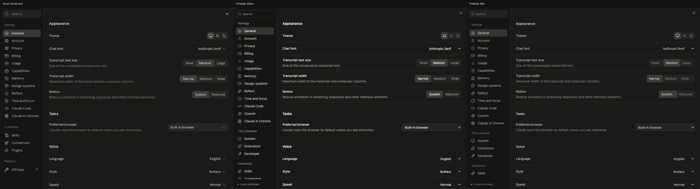

# Claude web UX reference — 2026-10-15

Inspected the signed-in Claude web application in the user-authorized Chrome profile at a 1470 × 942 CSS-pixel viewport. Evidence is visible DOM, computed styles, geometry, and a cropped screenshot. No messages were submitted, account preferences changed, or private conversations opened. This is a runtime observation, not access to Claude server source.

## Measurements and changes

| Surface | Observed web behavior | Prototype change |
| --- | --- | --- |
| Settings dialog | 1024 × 800, 12px radius, background #1a1a19 | Same desktop maximum geometry; responsive limits retained |
| Settings navigation | 192px wide, #151515 | Matched width and background |
| Settings content | 24px horizontal padding, 28px section gaps, 14/20px body, 15/20px headings | Matched spacing and typography sizes |
| General preferences | Transcript size/width and Tasks preferred browser | Added shared transcript controls and browser preference; retained Code aliases |
| Theme controls | 30 × 30px icon options, 6px corners | Matched dimensions; corrected light-mode segmented backgrounds |
| Model popup | About 172px wide, 13px text, 10px corners, #20201f | Matched model-specific popup treatment |
| Effort | Nested submenu; Low, Medium (Recommended), High, Extra, Max (3.5× or more usage), Ultracode | Nested radio menu with keyboard navigation and focus restoration |
| Fast mode | Separate checkbox in model popup | Per-session persisted demonstration preference |
| Shortcuts | New session ⇧⌘O; Settings ⇧⌘, | Added new-session alias; settings shortcut accepted |

The web model selector displayed Opus 5.5, Fable 5.1, Sonnet 5.5, and Haiku 5.5. The More models submenu contents were not inspected; the prototype does not invent an additional catalog. Permission options observed for a cloud session were Auto, Accept edits, and Plan.

## Platform distinctions and limits

The web Code landing page showed Recent environments, a selected Default cloud environment, Choose environment, and a bottom composer. Desktop evidence showed Import CLI and Auto actions. The prototype retains the desktop landing workflow and broader desktop settings/permission options rather than treating this account’s web configuration as universal.

The Code sidebar measured 299px in the existing session, but it is resizable; this is not evidence of a 299px default. Its computed font began anthropic-sans with system fallbacks. The subsequent font/icon pass copied the installed Anthropic Sans, Serif, and Anthropicons resources with SHA-256 provenance (`public/fonts/manifest.json`). Explicit System preferences still use platform fonts; rasterization can differ across browsers and operating systems. Backend execution, billing, credentials, native integrations, and account operations remain simulations.

## Screenshot provenance

[Actual Claude web General settings](reference/2026-10-15/claude-web-general.jpg) is a JPEG captured from the live browser, cropped to the dialog with a 2px inset. It excludes account identifiers and conversation history. The adjacent manifest records its SHA-256. Prototype release images are separately stored under screenshots/v1.2.0 and regression baselines under tests.

See [desktop shipped-artifact audit](SOURCE-AUDIT.md) for independent source evidence and [test documentation](../TESTING.md) for reproducible validation. These observations support specific refinements; they do not establish complete pixel or functional equivalence across all Claude versions, accounts, and operating systems.

## Iterative same-page comparison

After initial test completion, an explicit screenshot comparison found remaining differences in General: transcript width was a dropdown rather than segmented choices, descriptions were absent, and section baselines differed. These were corrected in a second pass and captured again. Main heading baselines now match at y=132,528,672,918; row heights match the measured reference. The reference uses 1470 × 942, a 1024 × 800 dialog at (223,71), and a 1020 × 796 interior capture at (225,73). Baseline passing alone is not evidence of reference parity.

The comparison retains desktop-only navigation categories rather than hiding them for the image. This historical v1.2 comparison predates the font/icon pass: its Anthropic Sans letter shapes, some icons, and native dropdown arrows differed. The subsequent pass uses matching installed font and icon bytes; this does not retroactively update these historical images or establish every-screen pixel identity. The reference is Chrome on macOS and the comparison uses Chrome for Testing on macOS. This is a documented improvement, not a pixel-identity certification.
