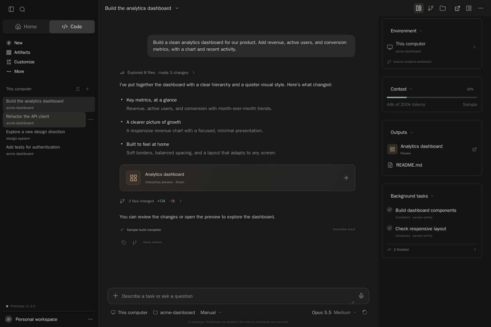
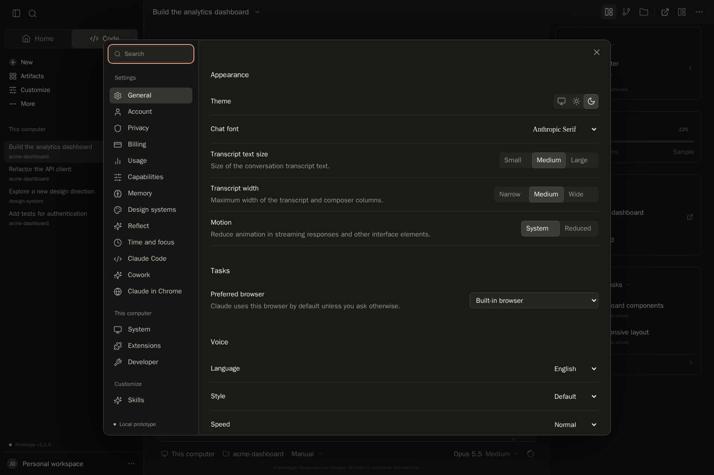
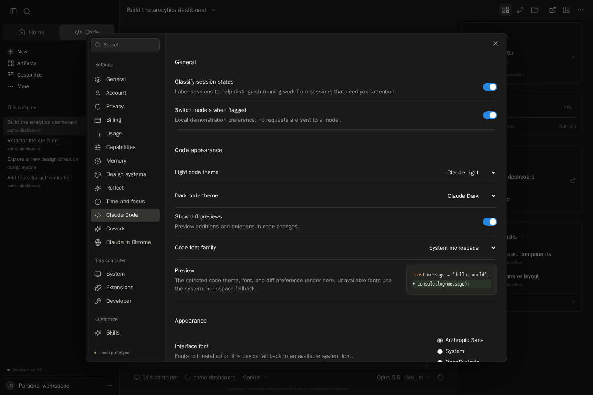
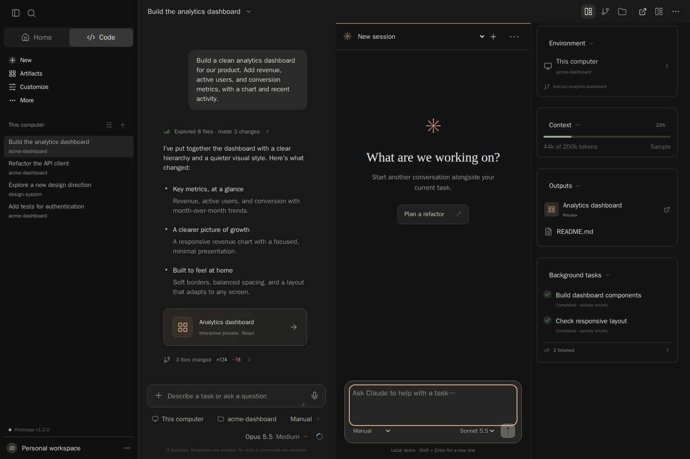
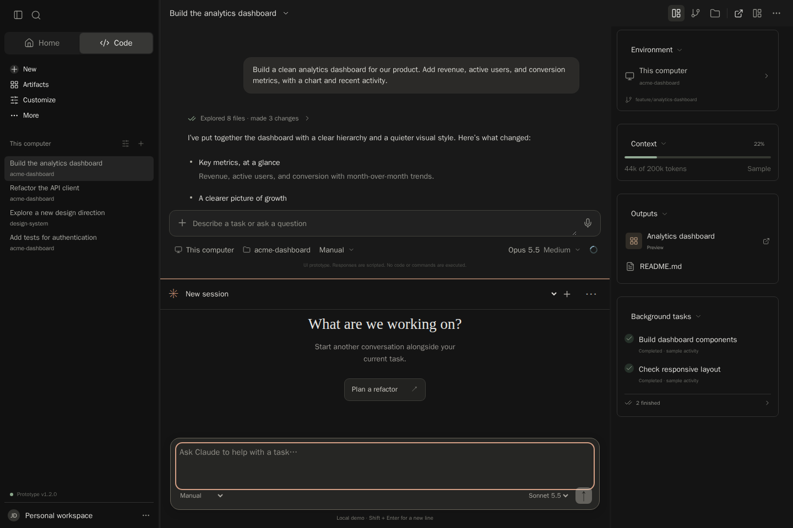
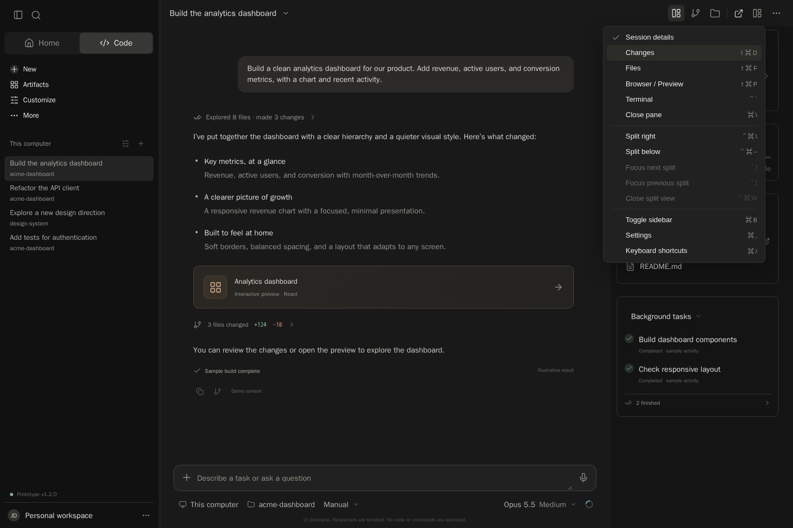
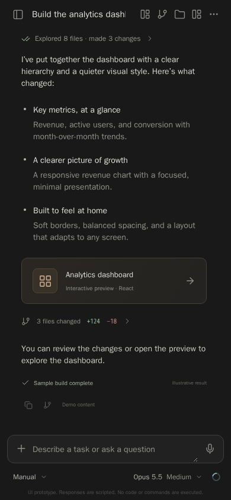
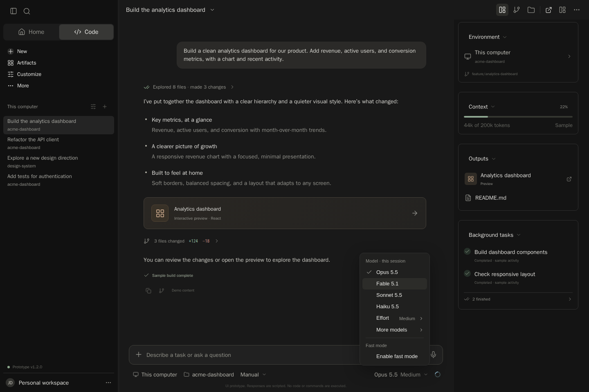
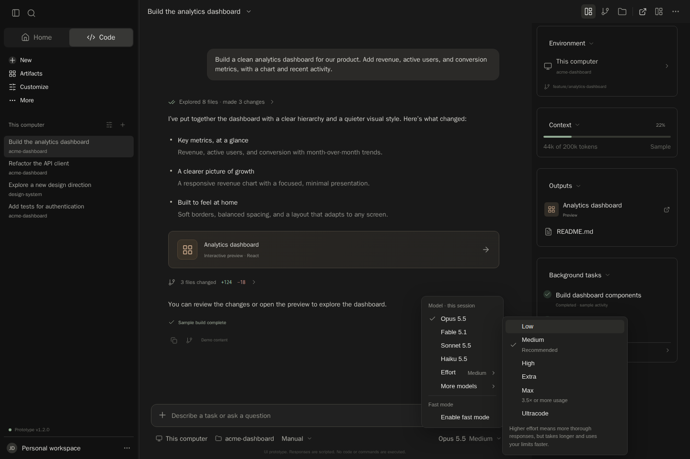

# Prototype v1.2.0

Production build captured by the pinned Linux Chromium test suite with sample data. The workspace image includes hovered session actions. These images are distinct from the actual Claude web reference under ../../reference/2026-10-15/.

## workspace.png

## settings-general.png

## settings-code.png

## split-right.png

## split-below.png

## layout-menu.png

## mobile-workspace.png

## model-effort.png

## model-effort-submenu.png

